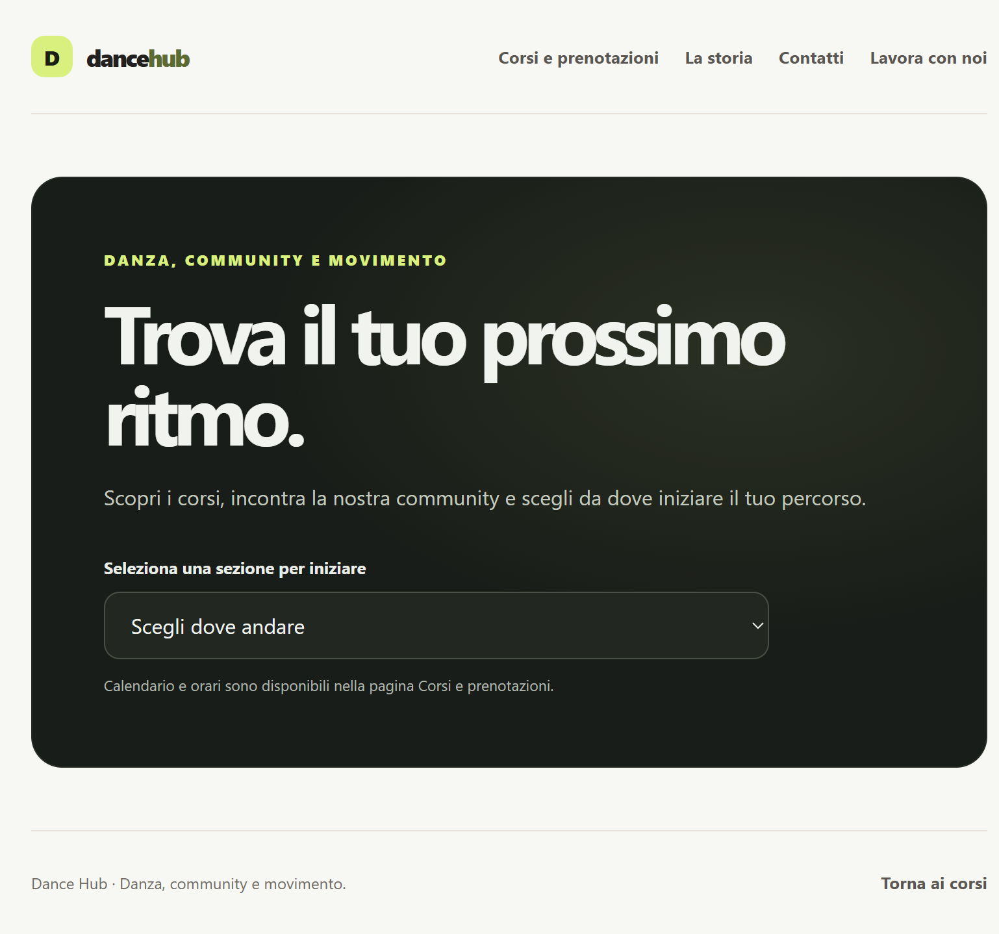

# Dance Hub

Dance Hub è una web app per scoprire e prenotare corsi di danza. Riunisce in un
unico spazio il catalogo delle lezioni, gli orari settimanali e gli strumenti
dimostrativi per allievi e insegnanti, con l'obiettivo di rendere più semplice
organizzare le attività della community.

## Anteprima



## Stack tecnologico

- [React 19](https://react.dev/) per l'interfaccia a componenti.
- [React Router 7](https://reactrouter.com/) per la navigazione multipagina.
- [TypeScript 5](https://www.typescriptlang.org/) per tipi e controllo statico.
- [Vite 6](https://vite.dev/) per lo sviluppo locale e la build.
- CSS personalizzato per layout, temi e animazioni (Tailwind CSS non è utilizzato).
- `localStorage` del browser per conservare prenotazioni e presenze.

## Funzionalità presenti

- Catalogo corsi filtrabile per disciplina e livello.
- Otto lezioni di esempio, presentate con insegnanti, orari, sale e disponibilità.
- Profili dei tre insegnanti nella pagina corsi, prima del catalogo.
- Sezione con tre corsi in evidenza, istruttori, orari e disponibilità.
- Sezione con i tre punti di forza della scuola: insegnanti, sale e community.
- Sezione con eventi e novità, date, descrizioni e link di approfondimento.
- Sezione con testimonianze degli allievi e relative discipline o anni di corso.
- Banner finale con invito a prenotare una lezione di prova tramite la pagina Contatti.
- Ricerca istantanea e filtri combinabili per disciplina, livello, giorno e insegnante.
- Indicatore posti occupati e prenotazione locale con contatore aggiornato subito.
- Modale di prenotazione con convalida del nome, protezione dalla capienza massima
  e controllo delle sovrapposizioni per lo stesso partecipante.
- Prenotazioni conservate nel browser tramite `localStorage`.
- Viste Allievi e Insegnante, con registro e gestione delle presenze prenotate.
- Badge dinamici per corsi quasi pieni e al completo.
- Tema chiaro/scuro e animazioni di comparsa con supporto alla riduzione del movimento.
- Identità visiva urban minimal: palette avorio e inchiostro con accenti lime.
- Calendario settimanale con giorno, orario, insegnante e sala.
- Layout responsive per desktop e dispositivi mobili.
- Pagine dedicate a catalogo, storia, contatti e candidature, con pagina 404
  per gli indirizzi non riconosciuti.
- Landing page iniziale con menu a tendina che naviga alle sezioni del sito.

Prenotazioni e presenze sono dimostrative: vengono salvate nel `localStorage`
del browser corrente, non su un server, e non sono condivise tra dispositivi o
browser diversi.

Il form "Lavora con noi" è una demo e non invia candidature. L'indirizzo email
e le informazioni sulla sede nella pagina Contatti sono segnaposto da
sostituire prima della pubblicazione.

## Quick start

Per avviare il progetto in locale, installa [Node.js LTS](https://nodejs.org/)
(npm è incluso) e lancia:

```sh
git clone https://github.com/giuliamilioli06-lgtm/dance-hub.git
cd dance-hub
npm install
npm run dev
```

Apri nel browser l'indirizzo mostrato da Vite nel terminale.
La landing page è disponibile alla root; il catalogo si trova su `/corsi`.

Per verificare i tipi e creare la build di produzione:

```sh
npm run build
```

Per visualizzare localmente la build:

```sh
npm run preview
```

## Struttura del progetto

- `src/components/`: componenti riutilizzabili.
- `src/components/PageLayout.tsx`: contenitore e footer delle pagine informative.
- `src/pages/`: pagine associate alle route.
- `src/pages/LandingHome.tsx`: pagina iniziale con menu di navigazione rapida.
- `src/pages/Home.tsx`: catalogo corsi, prenotazioni e calendario (`/corsi`).
- `src/pages/History.tsx`: storia e filosofia della scuola.
- `src/pages/Contact.tsx`: recapiti e informazioni sulla sede.
- `src/pages/Careers.tsx`: form dimostrativo per le candidature.
- `src/pages/NotFoundPage.tsx`: pagina mostrata per gli indirizzi non esistenti.
- `src/components/Navbar.tsx`: link di navigazione tra le route con React Router.
- `src/components/HomeControls.tsx`: filtri rapidi, ruolo e tema del catalogo.
- `src/components/FeaturedCourses.tsx`: griglia di tre corsi in evidenza nella landing.
- `src/components/InstructorsSection.tsx`: presentazione dei tre docenti in `/corsi`.
- `src/components/WhyUs.tsx`: punti di forza della scuola nella landing.
- `src/components/EventsSection.tsx`: eventi e novità della scuola nella landing.
- `src/components/Testimonials.tsx`: recensioni di esempio degli allievi nella landing.
- `src/components/CallToAction.tsx`: banner conclusivo per richiedere informazioni.
- `src/components/CourseCard.tsx`: scheda corso e controllo disponibilità.
- `src/components/BookingModal.tsx`: modulo di prenotazione.
- `src/components/AttendanceView.tsx`: elenco prenotati e registro presenze.
- `src/components/ScheduleView.tsx`: tabella degli appuntamenti settimanali.
- `src/types/index.ts`: interfacce e tipi TypeScript condivisi, incluso `Course`.
- `src/data/mockCourses.ts`: corsi di prova tipizzati con `Course`.
- `src/assets/`: immagini, icone e altri file multimediali.
- `src/App.tsx`: configurazione delle route di React Router.
- `src/main.tsx`: punto d'ingresso React.
- `vite.config.ts`: configurazione del server e della build.
